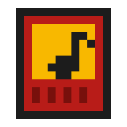

# FAMIMIMIDI SOUND EDITOR

ファミコン用 MIDI 音源カートリッジ「ふぁみみみっでぃ」専用の、音色の編集・管理ソフトです(Windows)。

> **非公式のソフトです。** ふぁみみみっでぃの作者(@hekekekun さん)とは関係がなく、作者さんへのお問い合わせはご遠慮ください。
> ふぁみみみっでぃの実装表(MIDI の仕様書)は同梱していません。作者さんが公開している公式の資料を参照してください。
> カートリッジへの書き込み(音色の保存など)は取り消せません。自己責任でお使いください。

## 起動

| ファイル | 内容 |
|---|---|
| **`run.bat`** | **いつもの画面**(ゲーム画面風。テーマは A: RPGウィンドウ / B: ファミコン本体カラー / C: ブラウン管 から選べる) |
| `run_classic.bat` | 予備の画面(以前の tkinter 版)。新しい画面が動かないときに |
| `make_shortcut.bat` | デスクトップにアイコン付きのショートカットを作る(1回だけ実行) |

- 使う前に Domino / Cubase を閉じてください(同じ MIDI ポートを取り合うため)。
- 必要なもの: Windows 11、Python 3.14 か 3.13(64ビット。入れるときに「Add python.exe to PATH」にチェック)。両方あれば 3.14 を使います。
- 初回は `run.bat` が、このソフト専用の Python 環境を `vendor/wheels` に同梱した部品から**ネットを使わずに**作ります。
  フォルダ内の `.venv` が使えればそれを、使えなければ(別のパソコンにコピーしたときなど)`%LOCALAPPDATA%\FamimimidiEditor\venv` に作ります。

### 別のパソコンで使う
- `famimimidi-editor` フォルダごとコピーすれば、音色・演奏セット・設定(`user_data/`)もそのまま使えます。
- **置き場所は書き込めるフォルダに**(ドキュメント、デスクトップなど)。`C:\Program Files` の中は書き込めないので動きません(`run.bat` が知らせます)。
- カートリッジへの書き込みは、どちらか1台でだけ行ってください。`user_data/cartridge.json` が「カートリッジに何を書いたか」の唯一の控えです。書き込んだら `user_data` をもう一方にコピーしてそろえます。
- MIDI の出力・入力は、最初に「⚙ 接続と設定」で選び直してください。

## できること

- **音色の編集**: かんたん表示(デューティ比の絵、エンベロープのグラフをつまんで動かす、ビブラートなどのカード。「?」で説明)/詳細表示(全項目)、おまかせ(基本とゲーム風)、画面の鍵盤、テストフレーズ
- **音色ライブラリ**: PC への保存・読み込み、バックアップ、MIDI ファイル書き出し、A/B 比較
- **★ カートリッジ**: 40か所の保存場所に音色を入れる、呼び出して鳴らす、電源を入れたときの音色、切り替えを整える(共通の土台と後始末)
- **鍵盤の弾き方**: 外部の鍵盤の演奏を割り当て表で ch に振り分ける(ch ごとの鍵域・オクターブ、ch1+ch2 の2音/重ねる)。ベース+メロディなどはひな形から
- **演奏セット**: 5ch の音色と割り当て表をまとめてライブラリに保存・読み込み(実機での確認中)
- **波形メモリ(ch5)**: 波形を描いて試聴、PC61〜76 に登録
- **詳細な管理**(上級者向け): 1つずつ試す、まとめて割り当て、10項目を並べ替えて書き込む、内部の対応表
- 送ったものは全部、画面と `logs/` に残ります。カートリッジへの書き込みは、必ず確認画面を通ります。

## データ

`user_data/` に、音色ライブラリ・カートリッジの対応表(何をどこに書いたか。カートリッジからは読み出せないため)・設定が入っています。
変更履歴(git)には含めていないので、大事なときはフォルダごとコピーするか、ライブラリの「バックアップ…」を使ってください。

## 開発者向け

| パス | 内容 |
|---|---|
| `CLAUDE.md` | 開発の約束ごと(実機で確定した事実、開発ルール、コード構成) |
| `docs/` | 仕様の要点、**実機検証ログ(03)**、音作りのノウハウ、要件、今後の計画(06) |
| `famimimidi/` | 本体。画面から独立した中身(engine / core / cartridge / sets …)と、新しい画面(`webapp.py` + `web/`) |
| `tests/` | 実機なしのテスト: `python -m unittest discover tests` |
| `hw_tests/` | 実機テストの MIDI ファイル生成と、確認手順書 |
| `reference/` | 最初の調査(claude.ai)で使ったスクリプト |
| `KICKOFF_PROMPT.md` | 最初に Claude Code に渡したプロンプト(記録) |
| `tools/make_icon.py` | アイコンを作るスクリプト(Pillow が必要。アプリ本体には不要) |

このソフトは、ユーザーが実機で確かめながら、Claude Code(Anthropic の AI)と一緒に作りました。開発の記録は `docs/` と `hw_tests/` にあります。

## ライセンス

MIT(`LICENSE`)。同梱しているフォントと Python の部品は、それぞれのライセンスに従います(`THIRD_PARTY_NOTICES.md`)。
