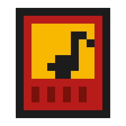

# FAMIMIMIDI SOUND EDITOR

ファミコン用 MIDI 音源カートリッジ「ふぁみみみっでぃ」専用の、音色の編集・管理ソフトです(Windows)。

> **非公式のソフトです。** ふぁみみみっでぃの作者(@hekekekun さん)とは関係がなく、作者さんへのお問い合わせはご遠慮ください。
> ふぁみみみっでぃの実装表(MIDI の仕様書)は同梱していません。作者さんの公式サイト http://famimimidi.dojin.com で公開されている資料を参照してください。
> カートリッジへの書き込み(音色の保存など)は取り消せません。自己責任でお使いください。

## 起動

| ファイル | 内容 |
|---|---|
| **`run.bat`** | **アプリを起動**(ゲーム画面風。テーマは RPGウィンドウ / ファミコン本体カラー / ブラウン管 から選べる) |
| `make_shortcut.bat` | デスクトップにアイコン付きのショートカットを作る(1回だけ実行) |

- 使う前に Domino / Cubase を閉じてください(同じ MIDI ポートを取り合うため)。
- 必要なもの: Windows 11、Python 3.14 か 3.13(64ビット。入れるときに「Add python.exe to PATH」にチェック)。両方あれば 3.14 を使います。
- 初回は `run.bat` が、このソフト専用の Python 環境を `vendor/wheels` に同梱した部品から**ネットを使わずに**作ります。
  フォルダ内の `.venv` が使えればそれを、使えなければ(別のパソコンにコピーしたときなど)`%LOCALAPPDATA%\FamimimidiEditor\venv` に作ります。

### 別のパソコンで使う
- `famimimidi-editor` フォルダごとコピーすれば、音色・演奏セット・設定(`user_data/`)もそのまま使えます。
- **置き場所は書き込めるフォルダに**(ドキュメント、デスクトップなど)。`C:\Program Files` の中は書き込めないので動きません(`run.bat` が知らせます)。
- カートリッジへの書き込みは、どちらか1台でだけ行ってください。`user_data/cartridge.json` が「カートリッジに何を書いたか」の唯一の控えです。書き込んだら `user_data` をもう一方にコピーしてそろえます。
- MIDI の出力・入力は、最初に「⚙ 接続と設定」で選び直してください。

## できること

画面の上のタブで「どこを触っているか」が決まり、鍵盤の振る舞いもタブで決まります(1〜5 = その ch だけを鳴らす、♪ = 演奏セットの割り当てで鳴らす)。

- **音色づくり(1〜5 のタブ)**: デューティ比の絵、エンベロープのグラフ、ビブラート・トレモロなどのカード。左の一覧から音色を入れる・保存する、おまかせの見本。ch5 は波形メモリの波形を描ける
- **演奏セット(♪ のタブ)**: 5ch の音色と鍵盤の割り当て(色の帯で鍵域を決める、ch1+ch2 をポリにする)、ペダル・レバーの使い道。ひな形あり。まとめてライブラリに保存できる
- **コードモード**: 鍵盤1本指でコード演奏(自作の「オタマコード」と同じ配置ほか、配置は3通り)。三角波がベース、パルス1・2と波形メモリが和音。曲ごとのコード進行(OtamaChord Studio のコードセットや、保存した ChordWiki のページからも取り込める。歌詞は取り込まない)、ボイシング、奏法プリセット
- **★ カートリッジ**: 保存場所40に音色を入れる・空にする・呼び出して鳴らす、電源を入れたときの音色、切り替えを整える、波形の登録、演奏セットまるごと。書き込みは必ず確認画面を通ります
- **🎮 仮想ファミコン**: ふぁみみみっでぃが無くても、このパソコンの音でそれっぽく鳴らして試せる(上の帯のボタンで切り替え)。カートリッジへの書き込みと実機の確認はできません
- **✓ 実機の確認**: アプリが音を鳴らし、「鳴った/鳴らない」をボタンで答える確認(基本の確認、保存場所を1つずつ試す など)。結果は `user_data/checks/` に残ります
- 送ったものは全部、画面と `logs/` に残ります

## データ

`user_data/` に、ライブラリ(音色と演奏セット)・作業中の演奏・曲・カートリッジの控え(何をどこに書いたか。カートリッジからは読み出せないため)・設定が入っています。
以前の版のファイルは、初めて起動したときに自動で新しい形に移し、元のファイルは `user_data/old_v1/` に残します。
変更履歴(git)には含めていないので、大事なときはフォルダごとコピーするか、ライブラリの「バックアップ…」を使ってください。

## 開発者向け

| パス | 内容 |
|---|---|
| `CLAUDE.md` | 開発の約束ごと(実機で確定した事実、開発ルール、コード構成) |
| `docs/` | 仕様の要点、**実機検証ログ(03)**、音作りのノウハウ、**仕様書(SPEC_v2)**、今後の計画(06) |
| `famimimidi2/` | 本体(`docs/SPEC_v2.md` で作り直した版)。device / model / music / performance / cartridge と、画面(`bridge.py` + `web/`) |
| `tests_v2/` | 実機なしのテスト: `python -m unittest discover -s tests_v2 -t .` |
| `hw_tests/` | 実機テストの MIDI ファイル生成と、MIDI ファイルで試す手順書 |
| `reference/` | 最初の調査(claude.ai)で使ったスクリプト |
| `tools/make_icon.py` | アイコンを作るスクリプト(Pillow が必要。アプリ本体には不要) |

このソフトは、ユーザーが実機で確かめながら、Claude Code(Anthropic の AI)と一緒に作りました。開発の記録は `docs/` と `hw_tests/` にあります。

## クレジット

- **ふぁみみみっでぃ(Famimimidi)**: へけけくん さん(X: [@hekekekun](https://x.com/hekekekun))/ 公式サイト http://famimimidi.dojin.com
  素晴らしいカートリッジを作ってくださったへけけくんさんに感謝します。このソフトは、ふぁみみみっでぃに MIDI を送るだけの非公式のアプリです。
- フォント: DotGothic16(Fontworks、SIL Open Font License 1.1)
- 開発: Kimama(実機での確認)と Claude Code(Anthropic の AI。プログラムの大部分を作成)

## ライセンス

MIT(`LICENSE`)。同梱しているフォントと Python の部品は、それぞれのライセンスに従います(`THIRD_PARTY_NOTICES.md`)。
